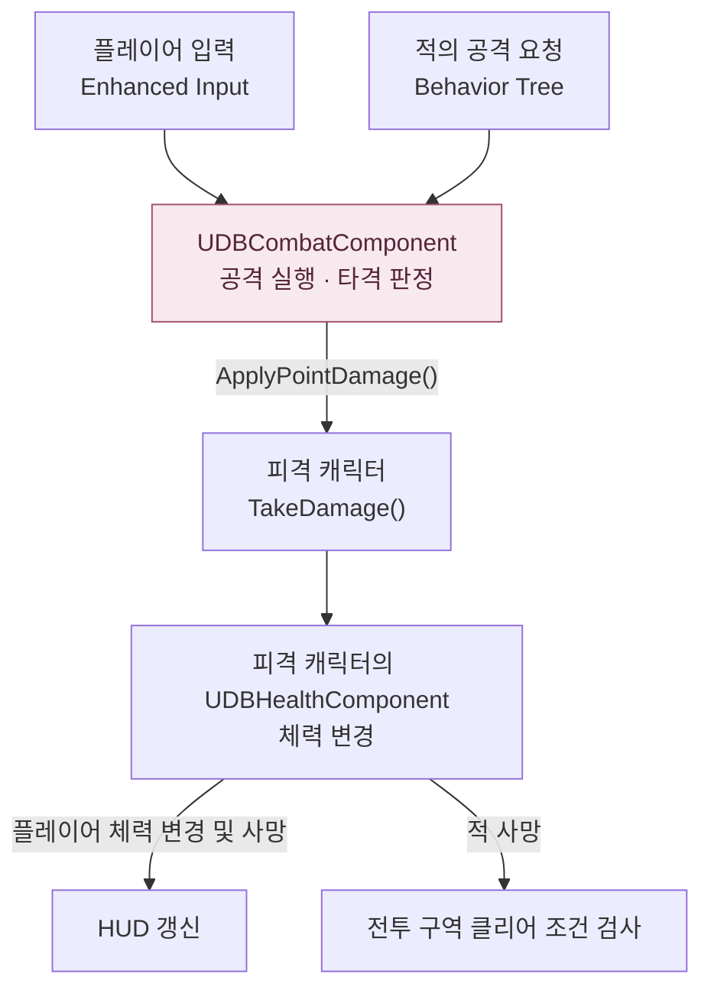
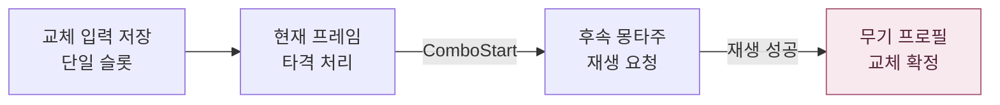
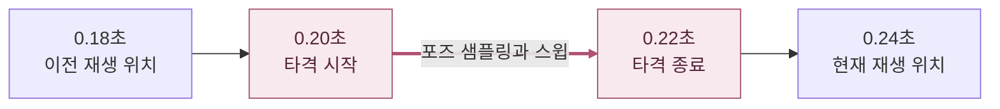
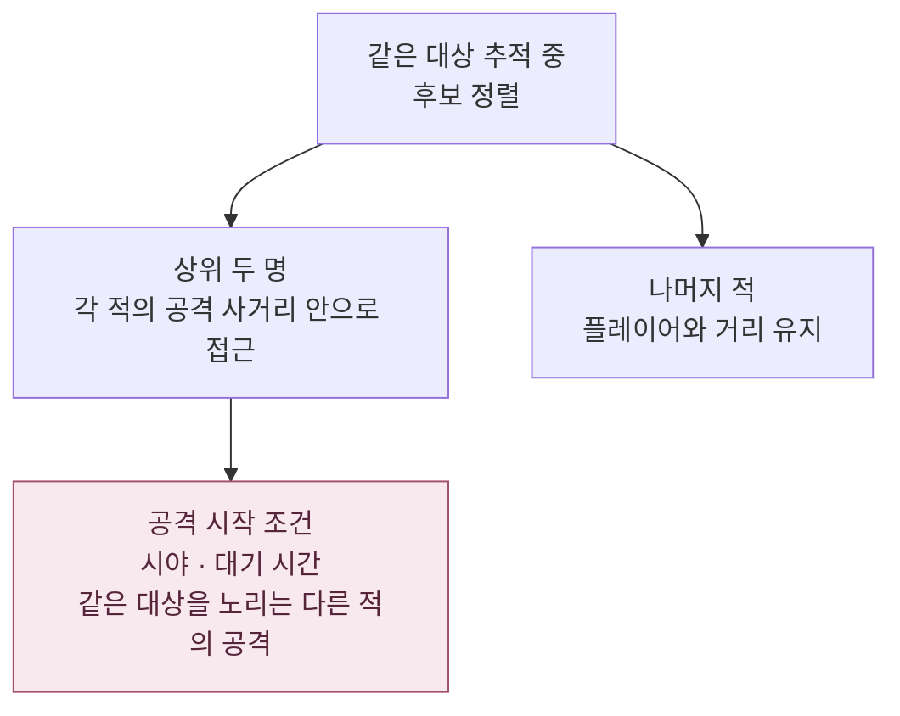

# DeftBlade

Unreal Engine 5와 C++로 개발한 3인칭 싱글플레이 액션 게임입니다.

[구현 범위](#구현-범위) · [기술 설계](#기술-설계)

## 구현 범위

- **플레이어 전투** — 약공격과 강공격의 콤보 분기, 무기 교체 콤보, 회피와 패링, 공중 콤보와 내려찍기를 구현했습니다.
- **적과 보스 AI** — 시야와 마지막으로 관측한 플레이어 위치를 기반으로 추적하며, 여러 적의 접근 위치와 공격 시작 시점을 제어합니다.
- **애니메이션과 타격 판정** — 공격 몽타주의 유효 타격 구간에 맞춰 칼날의 이동 경로를 스윕하고, 몽타주 종료 및 중단 시의 타격 판정과 내려찍기 공격의 착지를 처리합니다.

## 기술 설계

### 1. 언리얼 게임플레이 프레임워크 활용과 전투 시스템 설계

 

**플레이어와 적 AI가 동일한 공격 실행 및 타격 판정 로직을 사용하도록 구성**
플레이어와 적 캐릭터는 언리얼 엔진의 `ACharacter`를 상속하고, 각 클래스의 생성자에서 `CreateDefaultSubobject()`를 사용해 직접 구현한 `UDBCombatComponent`와 `UDBHealthComponent`를 생성합니다.

플레이어는 Enhanced Input을 통해 공격을 요청하고, 적 AI는 Behavior Tree에서 공격을 선택해 각자의 전투 컴포넌트에 전달합니다. 두 캐릭터는 동일한 전투 컴포넌트 클래스를 사용하므로 무기 데이터 조회, 공격 몽타주 재생, 타격 판정 로직을 재사용할 수 있습니다.

피해를 적용할 때는 언리얼 엔진의 `ApplyPointDamage()`를 호출합니다. 피격 캐릭터의 `TakeDamage()`에서는 전달받은 피해 정보를 자신의 체력 컴포넌트에 전달합니다.

[플레이어](Source/DeftBlade/Character/DBPlayerCharacter.cpp) · [적 캐릭터](Source/DeftBlade/Character/DBEnemyCharacter.cpp) · [공격 태스크](Source/DeftBlade/AI/BTTask_DBMeleeAttack.cpp)

 

**플레이어와 적의 공격 요청 및 처리 흐름**

 

**주요 클래스의 역할**

| 객체 | 역할 |
| --- | --- |
| `ADBPlayerCharacter`와 `UCharacterMovementComponent` | 플레이어 캐릭터는 이동 입력을 컨트롤러의 Yaw를 기준으로 변환해 `AddMovementInput()`에 전달합니다. 가속, 이동 모드, 캡슐 충돌은 엔진의 이동 컴포넌트에서 처리합니다. |
| `ADBEnemyAIController` | `OnPossess()`에서 인식 이벤트를 연결하고 Behavior Tree를 실행합니다. 적이 관측한 정보와 전투 중 이동할 목표 위치를 Blackboard에 저장합니다. |
| `UDBWeaponData`와 `UDBCombatComponent` | Data Asset에는 공격 몽타주, 타격 구간, 후속 공격 ID 등의 설정을 저장합니다. 전투 컴포넌트에서는 현재 공격 정보, 대기 중인 입력, 접촉을 처리한 대상 등 캐릭터마다 달라지는 데이터를 관리합니다. |
| `ADBGameMode`와 `ADBCombatEncounter` | GameMode는 `RestartPlayer()`에서 보스 재도전 시 플레이어의 스폰 위치를 결정합니다. Encounter는 전투 구역의 진행 상황을 관리하고 보스 재도전에 필요한 상태를 복원합니다. |

 

**멀티캐스트 델리게이트를 활용한 이벤트 처리**

체력 컴포넌트는 피해가 적용되면 `OnHealthChanged`를, 살아 있던 캐릭터가 사망하면 `OnDeath`를 브로드캐스트합니다. HUD는 플레이어의 체력 및 사망 이벤트를 받아 화면을 갱신하고, Encounter는 적의 사망 이벤트를 받아 전투 구역의 클리어 조건을 검사합니다.

멀티캐스트 델리게이트를 사용해 체력 컴포넌트가 HUD나 Encounter를 직접 참조하지 않도록 구성했습니다. 이를 통해 체력 관리와 UI 갱신, 전투 구역의 진행 처리를 분리했습니다.

[체력](Source/DeftBlade/Combat/DBHealthComponent.cpp) · [HUD](Source/DeftBlade/UI/DBPlayerHUDWidget.cpp) · [전투 구역](Source/DeftBlade/Game/DBCombatEncounter.cpp) · [GameMode](Source/DeftBlade/Game/DBGameMode.cpp)

### 2. 데이터 기반 콤보 시스템과 입력 버퍼

 

**공격 데이터와 콤보 분기**

공격 정의 구조체인 `FDBAttackDefinition`에는 현재 공격에서 이어질 수 있는 약공격, 강공격, 무기 교체 공격의 ID를 저장하는 `NextLight`, `NextHeavy`, `SwitchAttack`을 정의했습니다. 공격 간 연결 관계를 Data Asset에서 설정하므로 전투 로직을 수정하지 않고도 무기별 콤보 구성을 변경할 수 있습니다.

공격 설정은 `USTRUCT`로 정의하고 `UPROPERTY`를 사용해 에디터에서 편집할 수 있도록 구성했습니다. 현재 실행 중인 공격 정의의 복사본과 요청 ID는 각 캐릭터의 전투 컴포넌트에서 별도로 관리합니다.

무기별 공격 정의는 `TArray`에 저장하며, 직접 구현한 `FindWeaponAttack()`은 배열을 순회해 요청한 ID에 해당하는 공격을 찾습니다. 요청한 ID와 일치하는 공격 정의가 두 개 이상 존재하면 조회에 실패하도록 처리합니다.

공격 정의의 개수가 A개일 때 조회 시간 복잡도는 O(A)입니다. 무기별 공격 정의의 개수가 많지 않기 때문에 별도의 검색용 자료구조를 추가하지 않고 배열을 직접 순회하는 방식을 선택했습니다.

[공격 정의](Source/DeftBlade/Combat/DBWeaponData.h) · [전투 컴포넌트](Source/DeftBlade/Combat/DBCombatComponent.cpp)

 

**입력 버퍼와 입력 우선순위**

공격 도중 다음 공격이나 회피 입력을 받으면, 해당 동작을 즉시 실행할 수 없는 경우에도 입력을 저장해 두었다가 실행 가능한 시점에 처리하도록 입력 버퍼를 구현했습니다.

입력 버퍼에는 다음에 실행할 요청 한 건을 저장합니다. 회피 입력은 점프와 띄우기 입력보다 우선순위가 높으며, 일반 공격과 무기 교체처럼 우선순위가 같은 입력은 가장 최근에 받은 유효한 입력으로 버퍼를 갱신합니다.

동작이 진행되는 동안에는 미리 받은 입력을 유지하고, 실행 중인 동작이 없을 때 입력의 유효 시간이 지났는지 검사합니다. 입력 횟수와 관계없이 한 건의 요청만 저장하므로 입력 버퍼의 공간 복잡도는 O(1)입니다.

 

**무기 교체 콤보**

무기 교체 입력은 입력 버퍼에 저장합니다. 현재 프레임의 타격 판정을 먼저 처리한 뒤 몽타주의 재생 위치가 `ComboStart`에 도달하면 후속 몽타주의 재생을 시도합니다. 후속 몽타주 재생에 성공한 경우에만 무기 프로필의 교체를 확정합니다.

 

**무기 교체 입력에서 후속 공격까지의 처리 순서**

 

**이전 공격의 종료 콜백 처리**

콤보로 새로운 공격이 시작된 이후에도 이전 공격의 몽타주 종료 콜백이 전달될 수 있습니다. 이때 이전 공격의 종료 콜백에서 현재 실행 중인 공격을 종료하면 이미 시작된 후속 공격이 의도치 않게 중단될 수 있습니다.

이를 방지하기 위해 몽타주 종료 콜백에 연결한 공격 요청 ID와 현재 실행 중인 동작의 `ActiveActionId`를 비교합니다. 두 ID가 일치하는 경우에만 공격 종료 처리를 수행합니다.

몽타주 인스턴스 ID는 현재 실행 중인 몽타주의 재생 위치를 조회하는 데 사용합니다.

### 3. 애니메이션 기반 타격 판정과 실행 순서

 

**프레임 간 몽타주 재생 구간을 이용한 타격 판정**

공격 몽타주의 현재 재생 위치만 검사하면 프레임 간격이 길어졌을 때 유효 타격 구간을 건너뛸 수 있습니다.

예를 들어 칼날의 유효 타격 구간이 0.20~0.22초이고, 한 프레임에서 몽타주 재생 위치가 0.18초에서 0.24초로 진행되었다고 가정합니다. 현재 재생 위치인 0.24초만 검사하면 이미 유효 타격 구간을 벗어났기 때문에 타격 판정이 누락됩니다.

이를 방지하기 위해 직접 구현한 `TraceAttack()`에서는 이전 프레임과 현재 프레임 사이의 몽타주 재생 구간과 유효 타격 구간의 교집합을 구합니다. 위 사례에서는 0.20~0.22초 구간에 대해 타격 판정을 수행합니다.

`SampleTraceTransform()`에서는 해당 구간의 몽타주 포즈를 샘플링하고, 이전 프레임과 현재 프레임의 메시 월드 트랜스폼을 보간합니다. 여기에 본, 소켓, 무기 오프셋을 합성해 각 샘플링 시점의 무기 트랜스폼을 계산합니다.

이후 칼날 위의 여러 지점에 대해 연속된 두 포즈 사이의 이동 경로를 계산하고, 각 경로를 따라 구체 스윕(Sphere Sweep)을 수행해 접촉한 대상을 검출합니다.

[타격 처리](Source/DeftBlade/Combat/DBCombatComponent.cpp)

 

**한 프레임에서 유효 타격 구간을 건너뛰는 사례**

 

**몽타주 종료 시 마지막 타격 판정 누락 방지**

언리얼 엔진의 `USkeletalMeshComponent::FinalizeBoneTransform()`은 본 트랜스폼 갱신을 완료한 후 대기 중인 애니메이션 이벤트를 처리하고, 이어 `OnBoneTransformsFinalizedMC` 멀티캐스트 델리게이트를 브로드캐스트합니다.

전투 컴포넌트에서는 몽타주 종료 콜백으로 `AttackEnded()`를, 본 트랜스폼 갱신 완료 콜백으로 `BonesFinalized()`를 구현했습니다.

본 트랜스폼 갱신이 완료되는 시점에 몽타주 종료 이벤트가 대기 중이면 `AttackEnded()`가 `BonesFinalized()`보다 먼저 호출됩니다. 이때 `AttackEnded()`에서 공격 상태를 즉시 초기화하면 이후 호출되는 `BonesFinalized()`에서 마지막 타격 판정에 필요한 공격 정보를 사용할 수 없게 됩니다.

이를 방지하기 위해 몽타주가 끝까지 재생되어 종료된 경우에는 `AttackEnded()`에서 `bAttackEndedPending` 플래그를 설정해 공격 종료를 보류합니다. 이후 `BonesFinalized()`에서 몽타주 종료 시점까지 남은 구간의 타격 판정을 수행한 뒤, 연계 공격으로 전환하거나 현재 공격을 종료합니다.

반면 피격 등으로 몽타주가 도중에 중단된 경우에는 추가 타격 판정 없이 즉시 공격을 종료합니다.

 

**샘플링 횟수 제한과 중복 피해 방지**

프레임 간격이 길어질수록 검사해야 하는 몽타주 재생 구간이 늘어나므로, 샘플링 횟수에 제한이 없으면 한 프레임에서 많은 충돌 쿼리가 발생할 수 있습니다.

`TraceAttack()`에서는 프레임 사이의 몽타주 재생 구간과 각 유효 타격 구간이 겹치는 부분을 몽타주 시간 기준 1/120초 간격을 목표로 분할하되, 최대 32개 구간으로 제한합니다. 칼날도 기본 판정 반경을 기준으로 분할하며, 양 끝점을 포함해 최대 65개 지점에서 구체 스윕을 수행합니다.

분할 횟수에 상한을 두어 프레임 지연 시 충돌 쿼리 수가 과도하게 증가하지 않도록 했습니다. 다만 프레임 지연이 심한 경우에는 분할 횟수 제한으로 인해 샘플 간격이 넓어질 수 있습니다.

하나의 유효 타격 구간에서 여러 구체 스윕이 동일한 대상에 접촉할 수 있으므로, 이미 접촉을 처리한 대상은 해시 집합인 `TSet<TWeakObjectPtr<AActor>>`에 기록합니다.

동일한 타격 구간에서 이미 접촉을 처리한 대상은 이후 스윕 결과를 처리할 때 제외합니다. 다음 유효 타격 구간에 진입하면 집합을 비워 동일한 대상에 대한 타격 판정을 다시 수행할 수 있도록 했습니다.

#### 내려찍기 공격의 이동 충돌과 피해 판정 분리

기존 내려찍기 공격에서는 언리얼 엔진의 `Landed()` 콜백으로 전달된 충돌 결과를 사용해 착지 이펙트와 광역 피해를 계산했습니다.

하지만 적의 바로 위에서 내려찍기 공격을 수행하면 플레이어 캡슐이 적 캡슐과 충돌하면서 적의 캡슐 표면이 착지 표면으로 처리될 수 있었습니다. 이 경우 지면이 아닌 적의 캡슐 표면 법선을 기준으로 착지 이펙트의 방향이 결정되고, 지면까지 하강하기 전에 이동 상태가 변경되거나 하강 중 발생해야 할 피해 판정이 누락될 수 있었습니다.

엔진 소스의 `UCharacterMovementComponent::ProcessLanded()`에서 캐릭터로 착지 콜백이 전달되는 과정과 `SetBaseFromFloor()`에서 바닥 충돌 결과를 기반으로 이동 베이스가 설정되는 과정을 확인했습니다. 이후 캐릭터의 이동 충돌과 하강 중 타격 판정, 착지 충격파를 분리해 처리하도록 수정했습니다.

1. **캐릭터 간 이동 충돌 변경**

   내려찍기 공격 중에는 플레이어 캡슐의 `ECC_Pawn` 채널에 대한 충돌 응답만 `Block`에서 `Overlap`으로 변경합니다. 지형에 대한 기존 충돌 응답은 유지하므로, 하강 중 적의 캡슐과 겹치더라도 이동이 가로막히지 않고 지면까지 내려갈 수 있습니다.

2. **하강 경로를 이용한 타격 판정**

   플레이어 캡슐 하단의 이전 위치와 현재 위치 사이를 구체 스윕해 하강 경로에 있는 적을 검사합니다.

   이동 컴포넌트의 착지 콜백은 해당 프레임의 본 트랜스폼 갱신 완료 콜백보다 먼저 호출될 수 있습니다. 따라서 착지를 기록하기 전에 마지막 하강 구간을 한 번 더 검사해 타격 판정이 누락되지 않도록 했습니다.

3. **중복 피해 방지와 충돌 응답 복구**

   하강 중 접촉, 칼날 타격, 착지 충격파는 공통 피해 처리 로직과 동일한 대상 집합을 사용합니다. 이미 접촉을 처리한 적에게 중복 피해가 적용되는 것을 방지하기 위한 구조입니다.

   일반적인 공격 종료 시 플레이어 캡슐이 다른 캐릭터와 겹쳐 있다면, 겹침이 해소된 이후에 기존 충돌 응답을 복구합니다. 캡슐이 겹친 상태에서 `Block`으로 변경될 때 발생할 수 있는 밀림 현상을 줄이기 위해서입니다. 단, `ResetCombat()`으로 전투 상태를 초기화하는 경우에는 기존 충돌 응답을 즉시 복구합니다.

[내려찍기 구현 코드](Source/DeftBlade/Combat/DBCombatComponent.cpp)

### 4. 다수의 적 AI를 위한 접근 위치 배정과 공격 제어

여러 적의 공격 시작 간격을 제한하더라도 모든 적이 플레이어의 위치를 이동 목표로 설정하면 플레이어 주변에 적들이 밀집할 수 있습니다. 따라서 플레이어에게 접근할 적을 선정하는 과정과 실제 공격을 허용하는 과정을 분리했습니다.

같은 플레이어를 추적하는 적 중 최대 두 명에게 **각자의 공격 사거리 안으로 접근할 우선권**을 주고, **실제 공격 시작 시점**은 별도로 결정합니다.

[AI 컨트롤러](Source/DeftBlade/AI/DBEnemyAIController.cpp)

 

**접근 위치 배정과 공격 시작 조건**

 

**근접 공격 후보 선정**

`UpdateClosePressure()`에서는 같은 플레이어를 추적하는 살아 있는 적 중 시야를 확보했거나, 공격을 시작 또는 확정했거나, 교전 상태를 유지 중인 적을 후보 배열에 추가합니다.

수집한 후보는 다음 순서로 우선순위를 부여합니다.

- 공격을 진행 중이거나 공격이 확정된 적
- 최근 피격으로 교전 상태를 유지 중이거나, 기존 근접 공격 후보 중 현재 행동할 수 없는 적
- 기존 근접 공격 후보의 우선순위 유지 시간이 지나지 않은 적

우선순위가 같으면 각 적이 마지막으로 관측한 플레이어 위치까지의 수평 거리를 기준으로 비교합니다. 플레이어의 화면 안에 있는 적, 플레이어가 락온한 적, 이미 근접 공격 후보로 선정된 적에는 가산점을 부여합니다. 최종적으로 점수가 같은 경우에는 고유 ID를 비교해 순서를 결정합니다.

정렬 결과 상위 최대 두 명을 근접 공격 후보로 선정합니다.

같은 플레이어를 추적하는 적의 근접 공격 후보는 기본적으로 0.35초 간격으로 다시 평가합니다. 새로 선정된 적에게는 1.25초 동안 기존 후보 선정을 유지하기 위한 우선순위를 부여합니다.

이를 통해 플레이어와의 거리가 조금 달라질 때마다 근접 공격 후보가 바뀌는 현상을 줄이고, 공격을 진행 중이거나 교전 중인 적이 근접 위치를 우선적으로 유지하도록 했습니다.

 

**적의 이동 목표 결정**

`GetCombatLocation()`은 `GetAttackRange()`로 조회한 각 적의 공격 사거리를 기준으로 이동 목표를 결정합니다. 근접 공격 후보로 선정된 적은 자신의 공격 사거리 안에서, 나머지 적은 그보다 바깥쪽에서 이동할 위치를 찾습니다.

현재 위치나 이전에 설정한 이동 목표가 여전히 유효하다면 해당 위치를 재사용합니다.

새로운 이동 목표가 필요한 경우에는 플레이어 주변의 여러 각도에서 후보 위치를 계산하고, 각 위치를 NavMesh에 투영합니다. 다른 적과의 간격을 확보할 수 있는지, 실제로 이동 가능한 경로가 존재하는지 검사해 이동 목표를 결정합니다. 조건을 만족하는 위치를 찾지 못하면 현재 위치를 유지합니다.

 

**공격 시작 조건**

근접 공격 후보로 선정되었다고 해서 즉시 공격을 시작할 수 있는 것은 아닙니다. Behavior Tree의 공격 태스크에서 공격 사거리와 현재 행동 가능 여부를 확인하고, `CanStartAttack()`에서 다음 조건을 추가로 검사합니다.

- 플레이어에 대한 시야 확보 여부
- 근접 공격 후보 선정 여부
- 재공격 대기 시간 경과 여부
- 같은 플레이어를 추적하는 다른 적의 공격 확정 및 진행 상태

같은 플레이어를 추적하는 다른 적의 공격 요청이 입력 버퍼에 저장되어 있다면 새로운 공격을 시작하지 않습니다. 다른 적이 이미 공격을 진행 중인 경우에는 해당 공격의 마지막 타격 구간과 이후 설정된 짧은 대기 시간이 모두 지난 뒤에 새로운 공격을 시작할 수 있습니다.

이와 같이 공격 사거리 안으로 접근할 적의 수와 실제 공격이 시작되는 시점을 별도로 제어합니다.

 

**연산 비용과 확장 시 고려 사항**

월드에 존재하는 `ADBEnemyAIController`가 N개이고, 그중 근접 공격 후보 조건을 만족하는 적이 K개라고 가정합니다.

전체 AI 컨트롤러를 순회하는 과정의 시간 복잡도는 O(N)이며, 수집한 후보를 정렬하는 과정은 O(K log K)입니다. 따라서 근접 공격 후보 선정 1회의 시간 복잡도는 O(N + K log K)입니다. 이동 목표를 결정하기 위한 경로 검사와 별도의 공격 허가 검사 비용은 포함하지 않습니다.

현재 프로젝트는 한 전투에서 등장하는 적의 수가 많지 않기 때문에 후보를 배열에 수집한 뒤 정렬하는 방식을 사용했습니다. 여러 우선순위 조건과 동점 처리 규칙을 하나의 정렬 과정에서 처리할 수 있습니다.

향후 동시에 등장하는 적의 수가 크게 증가한다면 후보 정렬뿐만 아니라 전체 AI 컨트롤러 순회와 동기 방식의 경로 검사 비용을 우선적으로 프로파일링할 필요가 있습니다.
